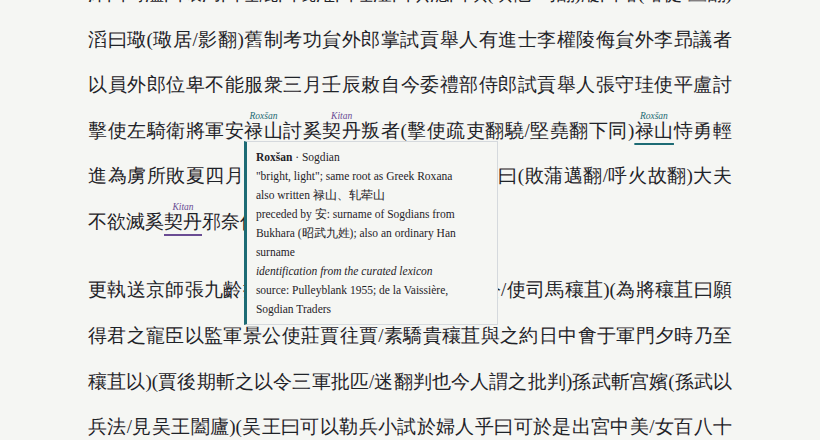
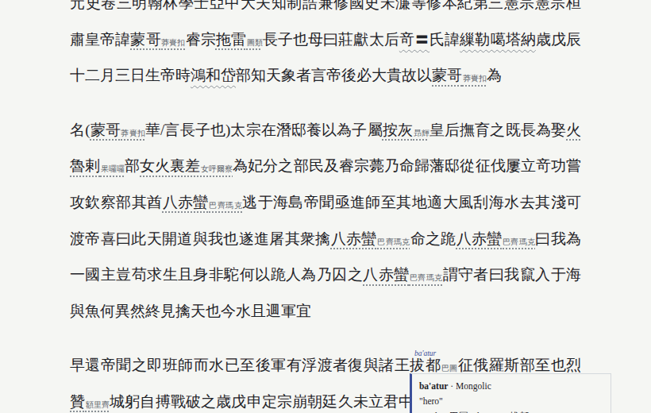

# 異名 yiming

**中国の史書で漢字に隠れた外来の名を浮かび上がらせる。**

[English](README.md) · [简体中文](README.zh-CN.md) · [한국어](README.ko.md) · [日本語](README.ja.md) · [Tiếng Việt](README.vi.md)



## なぜ作ったか

中国の史書は外国の人名・民族名・地名を漢字で書き記しました。そのため、名前の本来の姿が隠れてしまいます。

- **元の名前が消える。** 反乱を起こした安禄山の「禄山」は、ソグド語の *Roxšan*（「輝く」）で、ギリシア語の *Roxana* と同じ語源です。現代中国語で *Lùshān* と読んでも何も見えませんが、唐代の発音 *luk-ʂɛn* で読めば一目瞭然です。
- **一つの名前に、多くの表記。** オイラトは時代によって斡亦剌・瓦剌・厄鲁特・卫拉特と書かれます。オスマン帝国は明代には鲁迷（Rūm、「ローマ」）、清代には控噶尔、のちには土耳其です。
- **後世の編纂がさらに混乱させた。** 『四庫全書』の編纂にあたり、乾隆帝は遼・金・元三史の外来名をほぼすべて書き改めさせました（伯颜→巴延、脱脱→托克托、拔都→巴图）。ところがネット上の電子テキストの多くは四庫全書本です。

yiming は史書を読み込み、**外来の名前一つひとつの上に原語形を書き添えます**。語族ごとに色分けし、同じ名前の異なる表記は一つにそろえて表示し、乾隆期の改訳も元に戻します。**原文は決して書き換えません。** その箇所が実際に使っている表記は、常にそばに残ります。

## 現在できること

- **閲覧画面。** 外来の名前ごとに次の情報を表示します。
  - 上：原形（*Roxšan*、*Bayan*、*Rūm*）
  - 色：語族（12）
  - 下線：同定の確からしさ
  
  マウスを乗せると、言語・意味・出典・ほかの表記・同じ対象の別名が見られます。
- **時代ごとの発音。** 名前が書かれた時代の発音で比較します。
  - 漢〜唐：中古音（『切韻』）
  - 宋〜明：近古官話の近似
  - 清：清代官話の近似
  
  よく知られた音写の慣習も組み込んでいます。たとえば唐代には外国語の *-r/-l* を *-t* 韻尾で写しました（阙 = *kül*）。
- **二十四史だけではない。** Kanripo（約9,000点）からテキストを取得し、書物の時代に合った発音体系を自動で選びます。
- **四庫全書本の復元。**
  - 『欽定遼金元三史国語解』（約7,400組）を使います。
  - 同じ書物の二つの版を一字ずつ照合します（『元史』本紀で約3,600組）。
  - 一つの改訳表記が複数の旧名を置き換えた場合は推測せず、印を付けて候補を示します。
- **書籍サイト。** 一冊を小さなウェブサイトにします。
  - 巻ごとに一ページ
  - 巻ごとの外来名の量と語族構成を棒で示す目次
  - 各名前から登場する巻へリンクする名前索引
- **発見のための道具。**
  - 書中のすべての音写名の一覧を作ります。
  - 発音は近いが表記の異なる名前を探します（いわゆる「一人二伝」の候補）。
  - 任意で、原形不明の名前について LLM に候補を提案させます。時代の発音と合う提案だけを残します。
- **測定された精度。** 評価コマンドで、正しい同定と誤った同定がそれぞれどれだけ音の照合を通るかを確認できます（[精度](#精度)参照）。

## はじめ方

### 1. インストール

Python 3.8 以上が必要で、外部パッケージは不要です。

```bash
git clone https://github.com/<アカウント>/yiming.git
cd yiming
python yiming.py setup          # 異体字表を作成（インターネット接続が一度必要）
```

任意：

| パッケージ | 用途 |
|---|---|
| `pypinyin` | 韻書にない字の処理 |
| `anthropic` | `propose` コマンド |
| `opencc` | `mc_table.json` の再生成 |

### 2. テキストの用意

どちらか一方、または両方を使えます。

```bash
# (a) hunterhug/china-history の二十四史（約250MB）
git clone --depth 1 https://github.com/hunterhug/china-history.git corpus

# (b) Kanripo の任意の書物を、書名または KR 番号で
python yiming.py fetch 资治通鉴 --corpus corpus --juan 214
python yiming.py fetch 大唐西域记 --corpus corpus
```

### 3. 読む

```bash
# 一巻 -> 一ページ
python yiming.py read corpus/旧唐书/列传/第一百五十章-卷一百五十-原文.html -o anlushan.html

# 一冊まるごと -> 閲覧できるサイト（出力名に .html を付けない）
python yiming.py read corpus/元史 -o yuan_site
```

ブラウザで HTML を開いてください。[`samples/`](samples/) に作成済みの例があります。

## 画面の見方

**名前の上：** 原語形（イタリック）。言語だけ分かり原形が不明なときは ‹Khitan› のように表示します。

**色 = 語族**

| 語族 | 例 |
|---|---|
| イラン語派（ソグド語、バクトリア語、パルティア語、コータン・サカ語、ペルシア語） | 禄山 *Roxšan*、粟特 *Soγd*、安息 *Aršak*、哈烈 *Herāt* |
| テュルク語族 | 突厥 *Türk*、可汗 *qaγan*、回纥 *Uyγur*、鲁迷 *Rūm* |
| モンゴル語族 | 帖木儿 *Temür*、拔都 *ba'atur*、斡罗思 *Orus* |
| 準モンゴル語（契丹語、鮮卑語） | 契丹 *Kitan*、拓跋 *Tabγač*、耶律 |
| ツングース語族（女真語、満洲語） | 女真 *Jürchen*、勃极烈 *bogile*、贝勒 *beile* |
| チベット語 | 喇嘛 *bla ma*、拉萨 *Lha sa* |
| インド語派（サンスクリット語、パーリ語） | 佛陀 *Buddha*、阿罗汉 *arhat*、鸠摩罗什 |
| ドラヴィダ語族 | 古里 *Kōḻikkōṭ*（カリカット）、柯枝 *Kochi* |
| セム語族（シリア語、アラビア語） | 移鼠 *Išoʿ*（イエス）、默德那 *al-Madīna* |
| オーストロネシア語族 | 满剌加 *Melaka*、爪哇 *Jawa*、吕宋 *Luzon* |
| ヨーロッパの言語 | 和兰 *Holland*、利玛窦 *Matteo Ricci* |
| その他 / 不明 | 勃律 *Bolor*。灰色は原形がまだ分からないことを示す |

**下線 = 同定の確からしさ**

| 下線 | 意味 |
|---|---|
| 実線 | 整理済み語彙表による同定（出典あり） |
| 破線 | 音の照合を通った LLM の提案（出典は未確認） |
| 灰色の点線 | 音写らしいが原形不明 |
| 灰色の波線 | 一つの四庫改訳表記が複数の旧名を置き換えた例。マウスを乗せると候補が出る |

**名前の後ろの小さな灰色の字：** その箇所が実際に使っている表記。名前を統一表記で示すときに現れます。

**ツールチップ**（マウスを乗せるか、キーボードの Tab）：言語、意味、出典、ほかの表記、同じ対象の別名（鲁迷 ↔ 控噶尔 ↔ 土耳其）。唐代の史書で名前の前に安・康・石・米・何・史・曹があれば、その姓が指すソグドの都市も示します。

## 機能の詳細

### 時代ごとの発音と音の照合

各字の『切韻』音韻地位は nk2028 の `qieyun` データ（CC0）から取ります。名前は音類の列（声母類・母音類・韻尾）に変換されます。たとえば禄山は `LuK SaN`、*Roxšan* は `RuH SaN` です。

二つの名前、または名前とローマ字の原形を、重み付き編集距離で比べます。よく知られた音写の慣習は減点が小さくなります。

- *l* ↔ *r*
- *k* ↔ *x/h*
- 唐代に外国語の *-r/-l* を *-t* で写したこと
- 西北方言での鼻音声母の非鼻音化。そのため默が *b-* を表せます（默啜 = *Bäg Čor*）。
- 語末子音の脱落（颉利 = *Illig*）

| 体系 | 対象 | 主な規則 |
|---|---|---|
| `mc` | 漢〜唐・五代の史料 | 『切韻』の声母。*-p -t -k -m -n -ŋ* 韻尾を保持 |
| `om` | 宋・遼・金・元・明 | 入声韻尾が消失。疑母はゼロ声母。日母 ≈ *r* |
| `qm` | 清 | `om` と同じだが *-m* が *-n* に合流。尖音・団音の区別は保持（清代の満洲語音写の慣行） |

体系は編者の時代ではなく**史料の時代**で決めます。『明史』は清代に明代の資料で編纂されたので `om` を使います。まず書名の対応表を見て、次に取得時に記録した王朝を見ます。`--scheme` で直接指定することもできます。

**時代フィルター：** 語彙表の項目は、最も古い表記より古い書物では一致させません。そのため古里は明代の文献ではカリカットですが、『旧唐書』ではそうなりません。

### 名前：語彙表、表記、実体

| 表 | 内容 |
|---|---|
| `lexicon.tsv` | 整理済み123項目：原形、言語、語族、意味、漢字表記、出典 |
| `equivalence.tsv` | 同じ名前の異なる表記を一つにそろえて表示 |
| `entity` 列 | 一つの対象の異なる**名前**。リンクするだけで統合はしない |

簡体字・繁体字のどちらでも一致します。約21,000の異体字（竒 → 奇）を正字にそろえます。

### ほかの書物：Kanripo

```bash
python yiming.py fetch KR2a0036 --corpus corpus --juan 1-47 --name 元史_四库
```

テキストは `corpus/<書名>/NNN.txt` に整えられ、編者の王朝は `meta.json` に記録されます。四庫全書本には句読点がないため、ページ単位で段落を分けます。

### 四庫全書本：乾隆の改訳を戻す

1. `guoyujie` は『三史国語解』から「乾隆表記 → 旧表記」を抽出します。乾隆が主張する「満洲語・モンゴル語の意味」はこじつけが多いため、**使いません**。
2. `align A B` は同じ書物の二つの版を巻ごとに照合し、異なっていて音写らしい短い部分を集めます。四庫側の表記は旧版に現れないことが条件です。
3. Kanripo から取得した書物を読むと、改訳は自動で復元され、四庫の表記は小さな灰色の字で残ります。一つの改訳表記が複数の旧名を置き換えた場合（俄罗斯 が 斡罗思 *Orus* と 兀鲁思 *ulus* の両方を置き換えた例）は、そのまま残して波線を引き、ツールチップに候補と回数を示します。
4. 清代の文献はもともとその表記で書かれているので、**復元しません**。



### 書籍サイト

`read 書物フォルダ -o 出力フォルダ` は次のものを作ります。

- `index.html`：巻ごとに語族別の色の棒が付いた目次
- 巻ごとのページ（前後へのリンク付き）
- `names.html`：すべての名前を語族別にまとめ、回数と巻へのリンクを付けたもの

『旧唐書』201巻は約6秒で作れます。

### 発見のための道具

| コマンド | 働き |
|---|---|
| `scan` | 書中のすべての音写名の表：回数、状態、原形、語族、初出の文脈 |
| `twins` | 発音が近く表記の異なる名前（例：萧得里底 / 萧迭里得）。結論ではなく確認リスト |
| `propose`（実験的） | 不明な名前を、時代の発音と文脈一行とともに LLM に送ります。普通の漢語と判定されたものは除かれます。提案された原形は音の照合（≥ 0.60）を通ったものだけが残り、破線で表示されます。回答はキャッシュされます。**現時点では模擬応答でしか試していません。** |

### 精度

`python yiming.py eval gold_pairs.tsv --corpus corpus` の結果です（`samples/eval.txt`）。

**漢字表記 vs 原形：** 語彙表の正しい組166、誤った組19,920。

| しきい値 | 正しい同定が残る | 誤った同定が混じる |
|---|---|---|
| 0.55 | 78% | 4.0% |
| **0.60**（`propose` の既定値） | 72% | 2.2% |
| 0.70 | 54% | 0.75% |

**表記 vs 表記：** 既知の異表記19組、無作為な名前の組2万。0.80 で再現率79%、組あたりの誤検出率0.17%。

音が合うことはふるいにすぎず、証明ではありません。

## コマンド一覧

| コマンド | 用途 |
|---|---|
| `read ファイルまたはフォルダ -o 出力` | 閲覧画面。`.html` なら一ページ、そうでなければ書籍サイト。オプション：`--display latin`、`--known-only`、`--unknown-mean`、`--scheme`、`--siku on/off` |
| `find 語 --corpus フォルダ` | その語が出てくるファイル |
| `fetch 書名または番号 --corpus フォルダ` | Kanripo から取得。`--juan 1-10`、`--name` |
| `setup` | `variants.json`（異体字表）を作成 |
| `guoyujie` | 『三史国語解』から乾隆の改訳を抽出 |
| `align Aフォルダ Bフォルダ -o ファイル` | 二つの版を照合し、変えられた名前を集める |
| `scan`、`twins`、`propose` | 発見のための道具（上記） |
| `key 名前`、`match A B` | 古音の表示、二つの名前（または名前と原形）の比較 |
| `train --corpus フォルダ` | 音写によく使われる字を学習し直す |
| `eval gold_pairs.tsv` | 精度の報告 |

中国語による詳しい文書は [`docs/`](docs/) にあります（一ページ版：`docs/指南.html`）。

## 限界

- **名前の言語は文化的背景の証拠であって、血統の証明ではありません。** ほかの手がかり（姓、出身地、史書が「胡」と呼ぶこと）と一致すれば強い証拠です。外来の名前が流行した時代（元代の漢人のモンゴル名、僧侶のサンスクリット法名）には弱くなります。
- **カバー範囲は語彙表次第です。** 『元史』では約930の音写名を検出しますが、整理済み語彙表にあるのは約50です。残りは `propose` か人手で補うまで灰色のままです。
- **検出は統計的です。** 唐代の文献では一部の漢語（补阙など）を誤検出します。
- **四庫全書本の復元は完全ではありません。** 取りこぼす改訳があり、照合で隣の字が名前に混じることもあります。
- **`propose` はまだ実際の LLM の応答では試していません。**
- **語彙表の出典の多くは単に "standard"（通説）となっています。** 徐々に具体的な文献に置き換えるべきです。
- **『清史稿』は Kanripo の目録にはありますが、本文は公開されていません。**

## 現在の範囲を超えて使うには

### 現在の範囲

- **テキスト：** 二十四史（hunterhug）と Kanripo の書物。漢〜清の漢文史料です。
- **発音：** 『切韻』から導いた三体系 `mc`・`om`・`qm`
- **名前：** 内陸アジア・南アジア・西アジアの名前が中心で、一部に海域・ヨーロッパの名前があります。12の語族に分けます。

### 拡張のチェックリスト

1. **テキスト。** プレーンテキストを `corpus/<書名>/*.txt` に一段落一行で置きます（`.html` も可）。新しい出典なら小さな変換器を書きます。`corpora.clean_mandoku` を参考にしてください。
2. **時代。** `origin.py` の `BOOK_SCHEME` に書名を加えるか、書物の `meta.json` に `"scheme": "mc"` を書きます。
3. **発音。** `mc`・`om`・`qm` のどれも合わなければ、新しい体系を加えます。
   - `yiming.py` の `syllable()`（切韻に基づく規則）または `Phon.char_sylls()`（ほかの読み資料）を拡張し、各字が（声母類、韻尾類、母音類）を返すようにします。
   - 体系名をコマンドラインの選択肢と `origin.py` の `ERA` に加えます。
   - その言語に典型的な音の対応があれば、`yiming.py` の `SUB`・`INDEL` に加えます。
4. **名前。** `lexicon.tsv` に実在する出典付きで項目を加えます。新しい語族は `origin.py` の `FAMILIES` と CSS の色に加えます。
5. **表記。** 同じ名前の異表記は `equivalence.tsv` に入れます。四庫全書のように名前を変えた版があるなら、変えていない版と `align` で照合します。
6. **検出。** 新しいテキストで `train --corpus フォルダ` を実行します。その伝統に固有の音写用の字があれば、`origin.py` の `SEED_CHARS` に加えます。
7. **精度の確認。** その分野の確かな対応を `gold_pairs.tsv` に入れて `eval` を実行します。自分で測ったしきい値だけを信頼してください。
8. **LLM の提案（任意）。** `origin.py` の `PROMPT` を新しい分野に合わせて書き換えます。

### 場面別の案内

| 範囲 | 変えるもの |
|---|---|
| **朝鮮半島の漢文史書**（三国史記、高麗史、朝鮮王朝実録） | 女真・モンゴル・日本の名前は朝鮮の文人が音写したものが多くあります。朝鮮漢字音の体系を加えます（Unicode の Unihan データベースの `kHangul` 項目が読みを提供。朝鮮漢字音の *-l* は中古音の *-t* に対応）。朝鮮語族・日本語族なども加えます。 |
| **日本の漢文史書**（日本書紀、続日本紀など） | 朝鮮半島やアイヌの名前が漢字で表音され、万葉仮名に似た用法が多く見られます。日本漢字音の体系を加えます（Unihan `kJapaneseOn`。*-tsu/-chi* ↔ *-t*、*-ku/-ki* ↔ *-k*）。 |
| **ベトナムの漢文史書**（大越史記全書、欽定越史通鑑綱目） | チャンパ・クメール・タイの名前が出てきます。漢越音の体系を加えます（Unihan `kVietnamese`。*-t, -c, -p* を保持）。オーストロアジア語族・タイ・カダイ語族なども加えます。 |
| **仏典**（CBETA） | TEI XML の変換器を書きます。後漢の初期音写（浮屠など）は『切韻』より古いので、公表された再構に基づいて上古音または後漢音の体系を加えます。 |
| **より古い時代**（『史記』『漢書』の匈奴・西域） | 上と同じく、切韻以前の体系が必要です。原語について分かっていることが少ないため、精度は低くなります。 |
| **清末・民国の文献** | 西洋の名前は官話、または広東語・閩南語で音写されました。ピンインに基づく体系を加え、南方の文献には広東語の体系（Unihan `kCantonese`）を使います。 |
| **名前を変えたほかの版** | どの二つの版でも `align` で照合できます。 |

## データの出典とライセンス

[DATA_SOURCES.md](DATA_SOURCES.md) を参照してください。

- コードは MIT ライセンスです。
- `mc_table.json` は nk2028 の qieyun データ（CC0）に由来します。
- 例と四庫改訳表は Kanripo のテキストに由来します。再利用の前に Kanripo の条件を確認してください。
- `variants.json` は cjkvi の異体字表から手元で作るもので、リポジトリには含めません。
- hunterhug のテキストはこのリポジトリで再配布していません。

## 貢献

誤った同定や漏れを見つけたら、次の三点を知らせてください。

1. 書名と巻
2. その一文
3. 正しいと思う内容と、**その出典**

この三点があれば、誰でも検証して直せます。実在する出典付きの `lexicon.tsv` の修正を歓迎します。

## 謝辞

- nk2028（qieyun データ）
- Kanripo / 漢籍リポジトリ（テキスト）
- cjkvi（異体字表）
- hunterhug/china-history（二十四史コーパス）
- `lexicon.tsv` に引用した研究：Pulleyblank、de la Vaissière、Shimunek、そして鲁迷・控噶尔を考証した研究者たち
