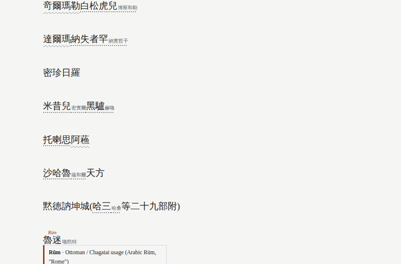
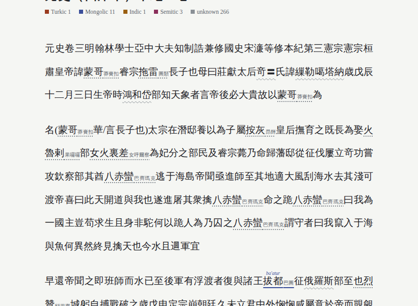
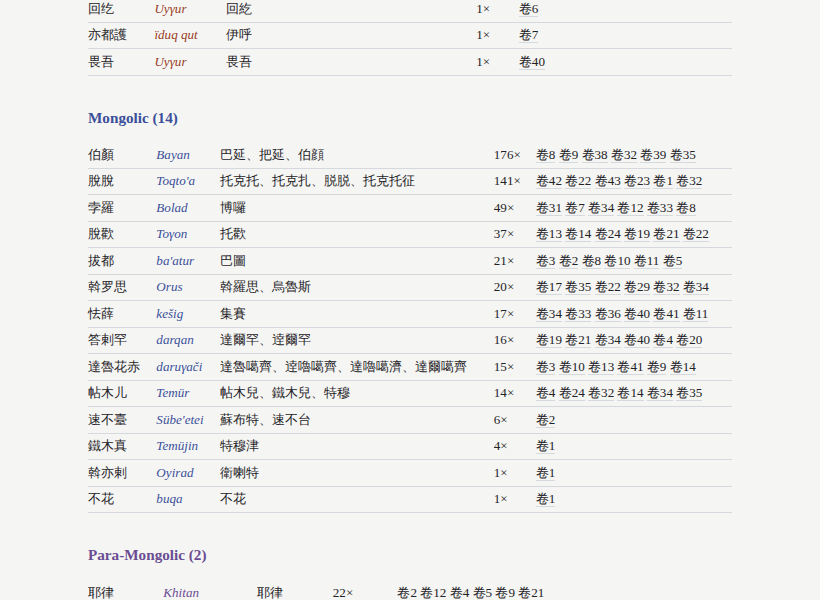
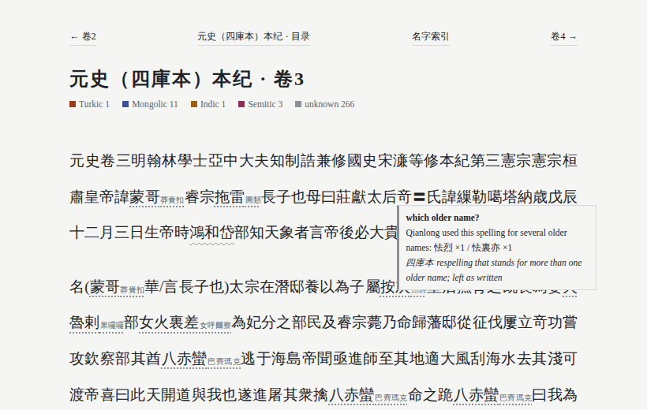

# 01 · 使用指南

本篇按实际使用的顺序写：先装好环境，再生成第一个阅读页面，然后学会看页面，最后逐个介绍命令。

---

## 一、需要准备什么

| 东西 | 是否必须 | 用途 |
|---|---|---|
| Python 3.8 或更高版本 | 必须 | 运行程序（作者在 3.12 上测试） |
| git | 建议 | 下载史书语料；没有也可以手动下载 |
| `pypinyin` | 可选 | 少数生僻字查不到古音时，用现代拼音代替 |
| `anthropic` 和 API key | 可选 | 只有用 AI 自动补充名字（`propose` 命令）时才需要 |

程序本身不依赖任何第三方库。

---

## 二、安装 Python

**Windows**

1. 打开 python.org，下载最新的 Python 3。
2. 安装时，**一定要勾选第一页下方的 "Add python.exe to PATH"**。这一步最常被漏掉。
3. 装好后打开"命令提示符"（开始菜单搜 `cmd`），输入：
   ```
   python --version
   ```
   看到 `Python 3.x.x` 就成功了。如果提示"不是内部或外部命令"，见 [05-注意事项与常见问题](05-注意事项与常见问题.md)。

**macOS**

1. 从 python.org 下载安装包安装。
2. 打开"终端"，输入：
   ```
   python3 --version
   ```

> 本文档里的命令都写成 `python`。**在 Mac 上请把 `python` 换成 `python3`。**

---

## 三、打开终端并进入 yiming 文件夹

先把 `yiming.zip` 解压，得到 `yiming` 文件夹。

- **Windows**：打开 `yiming` 文件夹，点击窗口上方的地址栏，输入 `cmd` 后回车。命令提示符会直接在这个文件夹里打开。
- **macOS**：打开"终端"，输入 `cd `（cd 后面有一个空格），然后把 `yiming` 文件夹拖进终端窗口，回车。

输入下面这行，确认程序能运行：

```
python yiming.py -h
```

屏幕上会列出所有命令。

---

## 四、下载语料

语料来自 GitHub 上的 hunterhug/china-history：二十四史原文，网页格式。在 `yiming` 文件夹里运行：

```
git clone --depth 1 https://github.com/hunterhug/china-history.git corpus
```

下载完后会多出一个 `corpus` 文件夹，大约 250MB。

**没有 git**：打开 github.com/hunterhug/china-history，点绿色的 **Code** 按钮，再点 **Download ZIP**。解压后把文件夹改名为 `corpus`，放进 `yiming` 文件夹。

关于这份语料，有三点要知道：

- 语料里带"白话"的文件夹是现代译文，程序会**自动跳过**。
- 这份语料里的《元史》**只有本纪、志、表，没有列传**。
- 二十四史止于《明史》，所以**没有清代文献**。

### 第二个来源：Kanripo（二十四史以外的书）

Kanripo（漢籍リポジトリ）是日本京都大学等整理的开放古籍库，收录数千种书：正史、编年、地理、佛典等。yiming 可以直接按**书名**或**编号**下载：

```
python yiming.py fetch 大唐西域记 --corpus corpus
python yiming.py fetch 异域录 --corpus corpus
python yiming.py fetch 元史 --corpus corpus --juan 1-47 --name 元史_四库
```

- 书名简体、繁体都可以。找不到时，可以改用编号，如 `KR2a0036`（编号可在 Kanripo 网站查）。
- `--juan 1-47` 只下载第 1 到 47 卷；不写就下载全书。
- 下载后，书的文件夹里会有 `meta.json`，记录作者的朝代。程序据此**自动选择读音方案**：汉唐用中古音，宋至明用近古官话，清代用清代官话。
- Kanripo 的底本**大多是四库全书本**。四库本的辽、金、元人名被乾隆改译过（见下文第十节）。
- Kanripo 的书目里列有《清史稿》，但**正文并未公开**，下载不到。

---

## 五、第一个阅读页面

```
python yiming.py read corpus/旧唐书/列传/第一百五十章-卷一百五十-原文.html -o 安禄山传.html
```

运行完，`yiming` 文件夹里会多出 `安禄山传.html`，双击用浏览器打开。

**不知道某个人物在哪个文件？** 用 `find` 查：

```
python yiming.py find 安禄山 --corpus corpus --books 旧唐书
```

它会按出现次数列出文件，并给出每个文件的一小段上下文。把列出的路径复制到 `read` 命令里就行。

---

## 六、阅读页面怎么看


### 1. 名字上方的斜体小字：原语言形式

例如"禄山"上方是 *Roxšan*。如果只知道语言、不知道原形，会显示成 ‹Khitan› 这样的尖括号。

### 2. 颜色：语系

页面上显示的是英文语系名，对照如下：

| 页面上的名称 | 中文 | 颜色 | 例子 |
|---|---|---|---|
| Iranian | 伊朗语族（粟特、巴克特里亚、帕提亚、于阗塞语、波斯） | 青绿 | 禄山 Roxšan、粟特、安息、哈烈 |
| Turkic | 突厥语族 | 砖红 | 突厥 Türk、可汗 qaγan、回纥 Uyγur、鲁迷 Rūm |
| Mongolic | 蒙古语族 | 靛蓝 | 帖木儿 Temür、拔都 ba'atur、斡罗思 Orus |
| Para-Mongolic | 类蒙古语（契丹、鲜卑） | 紫 | 契丹 Kitan、拓跋 Tabγač、耶律 |
| Tungusic | 通古斯语族（女真） | 绿 | 女真 Jürchen、完颜 |
| Indic | 印度语族（梵语等） | 赭黄 | 佛陀 Buddha、沙门 śramaṇa、鸠摩罗什 |
| Semitic | 闪米特语族（叙利亚语、阿拉伯语） | 梅红 | 移鼠 Išoʿ（耶稣）、摩尼 Mānī |
| Tibetic | 藏语 | 红 | 喇嘛 bla ma、拉萨 Lha sa、班禅 |
| Dravidian | 达罗毗荼语（马拉雅拉姆语等） | 土黄 | 古里 Calicut、柯枝 Cochin |
| Austronesian | 南岛语（马来、爪哇、他加禄） | 青蓝 | 满剌加 Melaka、爪哇 Jawa、吕宋 Luzon |
| European | 欧洲语言 | 灰蓝 | 佛郎机→和兰 Holland、利玛窦 Matteo Ricci、英吉利 |
| Other | 其他 | 深灰 | 勃律 Bolor、土鲁番 |
| unknown | 看起来是音译，但原形未知 | 浅灰 | |

页面顶部有本页各语系名字的出现次数，底部有按语系分组的索引表。

### 3. 下划线：可信程度

| 下划线 | 含义 | 怎么对待 |
|---|---|---|
| **实线** | 来自人工整理的词表，有学术出处 | 基本可信，但仍可能有学术争议 |
| **虚线** | AI 提出、并通过了读音核验的候选 | **未核实出处**，是线索，不是结论 |
| **细虚线** | 只凭读音相似（需要加 `--sound` 才会出现） | 很弱的线索 |
| **点线（浅灰）** | 程序认为像音译，但不知道原形 | 可能确实是外族名，也可能是汉语词被误判 |
| **波浪线（浅灰）** | 四库本里乾隆改译的写法，但它对应**不止一个**旧名（例如"俄罗斯"既替换过斡罗思 Orus，也替换过兀鲁思 ulus） | 程序不替你猜，悬停看候选，按上下文自己判断 |

### 4. 名字后面的灰色小字：原书写法

如果某个名字被统一成了标准写法，原书的写法会以灰色小字跟在后面。例如《元史》里的"雪不台"会显示成"速不台"，后面跟着小字"雪不台"。原文始终看得到。

有一个例外：像"本名斡啜，又作兀术"这种**正在讨论写法的句子**，程序会保持原样，不做统一，否则句子会变成"本名兀术，又作兀术"。





### 5. 鼠标悬停（或按 Tab 键）：详细信息

弹出框里可能有这些内容：

- **原形和语言**，例如：Roxšan · Sogdian
- **意思**，例如："bright, light"，与希腊语 Roxana 同根
- **这个名字的其他写法**
- **同一事物的其他名称**，例如：鲁迷 = 控噶尔 = 土耳其
- **昭武九姓提示**：唐代史书里，名字前面如果是安、康、石、米、何、史、曹，会提示这个姓对应的粟特城市，比如安 = 布哈拉。**这只是提示**，因为这些同时也是普通汉姓。
- **可信程度和出处**

---

## 七、命令详解

下面的例子都假设你在 `yiming` 文件夹里，语料在 `corpus` 文件夹。

### `read`：生成阅读页面（最常用）

```
python yiming.py read 文件或文件夹 -o 输出.html
```

| 参数 | 作用 |
|---|---|
| `-o 文件名.html` | 输出文件名 |
| `--title 标题` | 页面标题 |
| `--display latin` | 反过来显示：正文显示原语言形式，汉字写在上方 |
| `--known-only` | 只标注词表里有的名字，不显示浅灰点线 |
| `--unknown-mean 2.5` | 数字越大，浅灰点线越少（默认 2.0） |
| `--scheme mc` 或 `om` | 强制使用某种古音（一般不需要，程序会按书自动选） |

**读整本书：生成一个"书站"。** 输出名**不带 .html** 时，程序会生成一个文件夹，里面每一卷一页：

```
python yiming.py read corpus/旧唐书 -o 旧唐书_阅读
```

打开 `旧唐书_阅读/index.html`：

- **目录页**：每一卷后面有一条彩色横条，表示这一卷外族名字的多少和语系构成。浅灰部分是原形未知的名字。
- **每卷一页**：上下卷之间可以翻页。
- **名字索引**（names.html）：全书所有外族名字按语系分组，每个名字都列出出现次数，并链接到出现最多的几卷。

《旧唐书》两百卷，大约 6 秒生成。




如果输出名带 `.html`，整本书会生成**一个**大网页。这样打开很慢，不推荐。

### `find`：找某个词在哪些文件里

```
python yiming.py find 鲁迷 --corpus corpus --books 明史
```

### `scan`：给整本书的外族名字编索引

```
python yiming.py scan --corpus corpus --books 旧唐书 -o 旧唐书名字.tsv
```

输出是表格文件（TSV，可以用 Excel 或 WPS 打开）。每行一个名字，各列依次是：出现次数、写法、可信程度、原形、语言、语系、统一写法、说明、书名、第一次出现的上下文。

屏幕上还会显示整本书按语系和可信程度的统计。

`--min-count 5` 表示只列出出现 5 次以上的名字。

### `fetch`：从 Kanripo 下载书

见第四节。

### `variants`：生成异体字表

```
python yiming.py variants
```

四库本里满是"竒""圗""従"这样的异体字，这些字会导致名字对不上。这个命令从《汉语大字典》的异体字表（经 cjkvi 项目整理）生成 `variants.json`，约两万条，把异体字归并到正字。自带的包里**已经生成好了**，一般不用再运行。

### `guoyujie` 与 `align`：还原乾隆改译

见第十节。

### `propose`：让 AI 补充未知名字

详见下面第八节。

### `key`：看一个名字的古音

```
python yiming.py key 禄山 --scheme mc
```

它会逐字显示《切韵》音韵地位（如"來一東入"）和程序使用的音类。

### `match`：比较两个名字

```
python yiming.py match 禄山 Roxšan
python yiming.py match 速不台 雪不台
```

它会给出 0 到 1 的相似度，并同时显示中古音（mc）和近古官话（om）两套结果。第二个名字可以是拉丁字母写的原形。

### `twins`：找读音相近、写法不同的名字

```
python yiming.py twins --corpus corpus --books 辽史,金史 -o twins.tsv --emit-table 候选.tsv
```

它会在列传传主和"本名××"里，找出读音相近、写法不同的名字对，例如 萧得里底 / 萧迭里得、耶律棠古 / 耶律唐古。

- `--cross-book-only` 只找跨书的名字对。
- `--emit-table` 会把结果聚合成可以直接放进 `equivalence.tsv` 的候选行。

**注意**：`twins` 只说明**名字**读音相近，**是不是同一个人**要自己读原文判断。

### `eval`：看程序的准确率

```
python yiming.py eval gold_pairs.tsv --corpus corpus --books 金史,辽史,元史,明史,宋史
```

结果怎么解读，见 [02-原理](02-原理.md)。

### `train`：换语料后重新训练

```
python yiming.py train --corpus 你的语料文件夹
```

它会重新学习"哪些字常用于音译"，生成新的 `foreign_model.json`。用自带的二十四史语料**不需要**运行这一步。

---

## 八、用 AI 自动补充名字（`propose`）

自带词表有一百多条。拿《元史》来说，程序能找出约 930 个像音译的名字，其中只有 48 个在词表里。其余的可以交给 AI 补充。

### 准备

1. 在 Anthropic 的开发者平台申请 API key（说明见 docs.claude.com）。**调用 API 会按用量收费。**
2. 安装库：
   ```
   pip install anthropic
   ```
3. 设置 key，每次打开新的终端窗口都要重新设置：
   - Windows 命令提示符：`set ANTHROPIC_API_KEY=你的key`
   - Windows PowerShell：`$env:ANTHROPIC_API_KEY="你的key"`
   - macOS：`export ANTHROPIC_API_KEY=你的key`

### 使用

先看看会发给 AI 什么内容。这一步不花钱：

```
python yiming.py propose --corpus corpus --books 元史 --top 20 --dry-run
```

确认没问题后正式运行：

```
python yiming.py propose --corpus corpus --books 元史 --top 200
```

`--top 200` 表示问出现最多的 200 个未知名字。每 20 个名字调用一次，200 个大约调用 10 次。

### 程序做了什么

1. 把每个名字连同它的古音和一句上下文发给 AI。
2. AI 先判断**这到底是不是音译**。判为汉语普通词的（例如"补阙""金吾卫"的片段），以后就不再标出来。
3. 对确实是音译的名字，AI 提出原形和出处。
4. **程序用读音核验每个提议**：汉字的古音必须和提议的原形对得上（相似度 ≥ 0.60），对不上的直接丢弃。

### 结果

- **`lexicon_proposed.tsv`**：通过核验的提议。在阅读页面里显示为**虚线**。
- **`llm_cache.json`**：AI 的所有回答。再次运行不会重复提问，所以不重复收费，结果也不会变。删掉某个名字的记录，就会重新提问。

**AI 可能编造出处。** 读音核验只能过滤掉读音对不上的，过滤不掉"读音碰巧对得上、但其实是错的"。你查证过出处后，把那一行移到 `lexicon.tsv`，并把 status 改成 `attested`，它就会变成实线。具体见 [03-词表编写规范](03-词表编写规范.md)。

`--model-name` 可以指定模型，默认是 `claude-sonnet-5`。

---

## 九、文件夹里都有什么

| 文件 | 内容 | 可以改吗 |
|---|---|---|
| `yiming.py` | 主程序：命令、古音、比较 | 不需要 |
| `origin.py` | 音译检测、词表、AI 补充、阅读页面 | 不需要 |
| `lexicon.tsv` | **原形词表**（人工整理，123 条，12 个语系） | ✅ 可以加 |
| `equivalence.tsv` | **异写统一表**（同名异写 → 统一写法） | ✅ 可以加 |
| `lexicon_proposed.tsv` | AI 提议（运行 `propose` 后生成） | 自动生成 |
| `llm_cache.json` | AI 回答缓存 | 自动生成 |
| `foreign_model.json` | 音译用字模型 | `train` 生成 |
| `mc_table.json` | 每个字的《切韵》音韵地位 | 不需要 |
| `gold_pairs.tsv` | 评测用的已知异写对 | 可以加 |
| `corpora.py` | Kanripo 下载、异体字、四库本改译还原 | 不需要 |
| `variants.json` | 异体字 → 正字（约两万条） | `variants` 生成 |
| `equivalence_siku.tsv` | 《三史国语解》里的乾隆改译（约 7,400 条） | `guoyujie` 生成 |
| `equivalence_aligned_元史.tsv` | 《元史》中华本与四库本对照得到的改名（约 3,600 条） | `align` 生成 |
| `cache/` | Kanripo 书目缓存 | 自动 |
| `samples/` | 示例页面和示例输出 | |
| `docs/` | 本文档 | |

---

## 十、四库本：还原乾隆改译的人名

### 问题

乾隆修《四库全书》时，下令把辽、金、元三史里的外族人名、地名"按国语改正"，编成《钦定辽金元三史国语解》。于是四库本里：

| 中华书局本（旧译） | 四库本（乾隆改译） |
|---|---|
| 伯颜 | 巴延 |
| 脱脱 | 托克托 |
| 蒙哥 | 莽赉扣 |
| 拖雷 | 图类 |
| 拔都 | 巴图 |
| 阿里不哥 | 额哷布格 |

不只三史如此。四库本的其他书，比如《宋史》和各种宋元笔记，也跟着改了。**Kanripo 的书大多是四库本**，不处理的话，这些名字一个也对不上。

### yiming 怎么处理

1. **`guoyujie`**：从 Kanripo 下载《三史国语解》全部 46 卷，逐条提取"新译 ← 旧译"，生成 `equivalence_siku.tsv`（约 7,400 条）。
2. **`align`**：如果同一部书有两个版本（例如 hunterhug 的中华本《元史》和 Kanripo 的四库本《元史》），逐卷比对两者，把所有被改动的名字找出来：

   ```
   python yiming.py align corpus/元史 corpus/元史_四库 -o equivalence_aligned_元史.tsv
   ```

   这比《国语解》更全，因为《国语解》并没有收全书中所有被改的名字。
3. **阅读时自动还原**：读 Kanripo 下载的四库本（`meta.json` 里记着版本）时，程序自动把改译还原成旧译，改译写法以灰色小字保留在后面。


### 一个改译对应多个旧名时

乾隆有时把**几个不同的旧名**改成**同一个**新写法。例如"俄罗斯"既替换了"斡罗思"（Orus，罗斯），也替换了"兀鲁思"（ulus，"百姓、领地"）。这时程序**不替你选**：原文保持"俄罗斯"，下面画**波浪线**，悬停可以看到各个候选及出现次数。读者按上下文判断，例如"拔都征俄罗斯部"显然是罗斯。



### 什么时候不还原

- 清代文献（例如《异域录》）本来就用乾隆时代的写法，**不还原**。
- 中华书局本（hunterhug 语料）本来就是旧译，也不需要还原。
- 想手动控制：`--siku on` 强制还原，`--siku off` 关闭。
